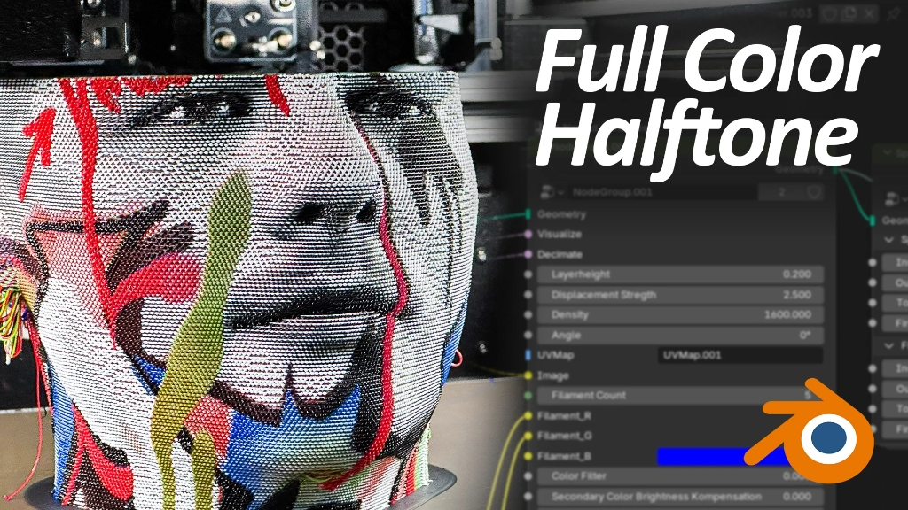
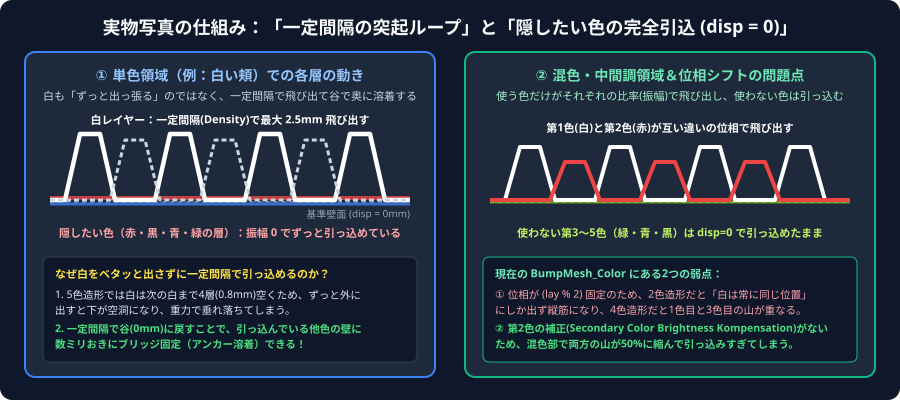
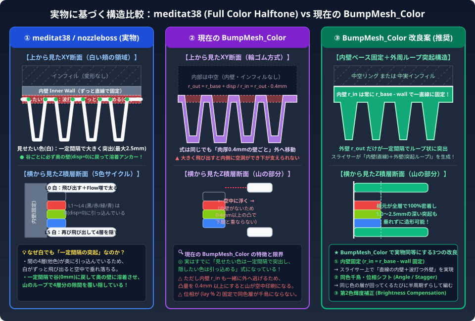

# `meditat38/nozzleboss` (Full Color Halftone) vs `BumpMesh_Color` 構造比較資料

添付いただいた実物写真（Full Color Halftone）と、右側に写っている Blender Geometry Nodes のパラメータから、`meditat38` 氏のハーフトーン・編み重ねの正確な仕組みが完全に判明しました。



---

## 1. 実物写真から判明した「本当の仕組み」

ご指摘の通り、**デューティ比（山の横幅）を変動させているのではなく、「見せたい色は一定間隔で飛び出し、隠したい色はずっと奥に引っ込めている」** のが実際のアルゴリズムです。

### 写真右側の Geometry Nodes パラメータの意味
* `Layerheight`: `0.200`（1層の厚み 0.2mm）
* `Displacement Stregth`: `2.500`（波の山の最大突出量 **2.5mm**）
* `Density`: `1600.000`（周方向の波の周期・密度。常に一定間隔）
* `Angle`: `0°`（層ごとの波の位相シフト角度）
* `Filament Count`: `5`（5色サイクル積層）
* `Filament_R` / `Filament_G` / `Filament_B`（各フィラメントのRGB色指定）
* `Color Filter` / `Secondary Color Brightness Kompensation`（ピクセル色から各フィラメントの突出率を計算するフィルタと、混色時の第2色の突出量ブースト補正）
* 右隣のノード群：`Speed` / `Flow`（内壁・外壁・ツール切替・1層目の速度と流量設定）

### なぜ「白い頬」の部分でもずっと飛び出さず、一定間隔で飛び出ているのか？
1. **隠したい色の層はずっと引っ込めている (`disp = 0`)**:
   5色プリントでは、白の次は「黒 → 赤 → 緑 → 青」の4層（高さ `0.8mm` 分）が積層されます。白い頬の領域では、これら4色は見せたくないため、**波打たずにずっと基準壁面（`disp = 0`）に引っ込めたまま** 通過させます。
2. **見せたい色（白）も一定間隔で谷（`0mm`）に戻らないと空中で垂れ落ちる**:
   もし白の層が「ずっと `+2.5mm` 出っ張ったまま」移動すると、下の4層（黒・赤・緑・青）は奥に引っ込んでいるため、白の足元に `0.8mm` の空中ギャップができてしまい、重力で垂れ落ちてしまいます。
3. **一定間隔で出し入れして「奥の壁にアンカー溶着」させている**:
   そこで、100%白の領域であっても、白の層を **`0mm`（奥）⇄ `+2.5mm`（手前）と一定間隔（`Density: 1600`）で激しく出し入れ** します。これにより、**波の「谷（`0mm`）」のたびに奥で積み上がっている他色の壁（および内壁）にガッチリ溶着（アンカー固定）** し、波の「山（`+2.5mm`）」のループがぷっくりと張り出して間の4層の隠れた色を覆い隠しています（タオル地のパイルやニットの編み目と同じ構造）。



---

## 2. では、現在の `BumpMesh_Color` と何が違うのか？（断面図で比較）

実は、現在の `BumpMesh_Color`（[weaveTubeGenerator.js](file:///c:/Users/Vogler/Documents/3dprint/Antigravity/BumpMesh_Color/js/weaveTubeGenerator.js#L309) および [previewMaterial.js](file:///c:/Users/Vogler/Documents/3dprint/Antigravity/BumpMesh_Color/js/previewMaterial.js#L230)）の変位計算式も：
```javascript
const disp = -concaveVal + stroke * exposure * B;
```
となっており、**「見せたい色（`exposure = 1`）は一定間隔 `B` で飛び出し、隠したい色（`exposure = 0`）は `-concaveVal`（`0`）でずっと引っ込める」という点ではすでに `meditat38` と同じ式** になっています。

それにもかかわらず、実物写真のような深い編み目（`Displacement Strength: 2.5mm`）や5色ハーフトーンを作ろうとすると違いが出る理由は、**以下の断面構造と位相・混色補正の違い** にあります。



---

## 3. `meditat38/nozzleboss` と現在の `BumpMesh_Color` の詳細比較表

| 比較項目 | ① `meditat38/nozzleboss` (実物写真の方式) | ② 現在の `BumpMesh_Color` ([weaveTubeGenerator.js](file:///c:/Users/Vogler/Documents/3dprint/Antigravity/BumpMesh_Color/js/weaveTubeGenerator.js)) | ③ `BumpMesh_Color` への改良案 |
| :--- | :--- | :--- | :--- |
| **基本の数式** | `disp = Strength * weight * Wave(Density)`<br>（見せたい色は一定間隔で突出、隠したい色は `0` でずっと引込） | `disp = -concave + stroke * exposure * B`<br>（**式自体はすでに同じ！**） | 現在の式をベースに維持 |
| **【違い①】奥の支え（内壁の有無）** | **内壁（Inner Wall）が `0mm` の内側に常に固定存在**。<br>そのため外壁が `2.5mm` 飛び出しても、谷で必ず内壁＆下層に溶着し、中空にならず崩れない。 | **内壁がなく、肉厚 `0.4mm` の1本の輪ゴムごと外へ移動**（`r_in = r_out - 0.4mm`）。<br>そのため凸量を `0.4mm` 以上にすると、山の下に支えがなくなり空中に浮いてしまう。 | **【改良A：内壁ベース固定】**<br>`r_in = r_base - wall` に固定（またはベース内壁を残す）し、外壁 `r_out` だけを突起させる。これで `1.0〜2.5mm` の大きな突起でも崩壊しない。 |
| **【違い②】層ごとの波の位相（並び方）** | `Angle` パラメータ等で制御。単色領域でも同じ色の層が重なる際に網目状に並ぶ。 | `layerPhase = (lay % 2) * PI`（偶奇2周期）に固定。<br>・**2色時**: 白は常に偶数層＝位相 `0` 固定、黒は常に奇数層＝位相 `π` 固定となり、同じ色が縦一列の筋になる。<br>・**4色時**: 1色目と3色目が同じ位相 `0` で衝突する。 | **【改良B：多色対応の位相シフト＆Angle制御】**<br>1) 各色が異なる位相を持つ、または同じ色が回ってくるたびに半周期ずらす（千鳥編み）。<br>2) `Angle`（斜め編み角度）スライダーの追加。 |
| **【違い③】混色時の第2色の飛び出し量** | **`Secondary Color Brightness Kompensation`** により、2色が混ざる中間色で第2色の突出量が減衰しすぎるのを補正し、2色の山をしっかり噛み合わせる。 | [`computeMultiColorBlend`](file:///c:/Users/Vogler/Documents/3dprint/Antigravity/BumpMesh_Color/js/layerBlending.js#L108-L181) で `t` と `1 - t`（合計 `1.0`）に線形配分するため、50:50の混色部では両方の山が半分の高さ（`0.5`）に縮んで引っ込んでしまう。 | **【改良C：混色ブースト補正（Brightness Compensation）】**<br>混色領域で第1色・第2色の突出高さが沈み込まないよう、非線形ゲイン（補償パラメータ）を追加する。 |
| **【違い④】突出部の樹脂量（太さ）** | `nozzleboss.py` が引き伸ばされたループ長 `dist` に比例して `E` 値を増やし、さらに `Flow` で太らせるため、5層に1回の突出でも上下4層分の隙間を縦に覆い隠せる。 | スライサーが輪郭通りにパスを生成する。 | 【改良A】で内壁を固定すると、突起の付け根〜先端が三角形/台形の歯（フィン）形状になり、スライサーが突起内部に折り返しパス（またはArachne太線）を入れてくれるため、自然と太く強固なループになる。 |

---

## 4. `BumpMesh_Color` に取り入れるおすすめの選択肢

実物写真の仕組みを踏まえると、`BumpMesh_Color` の「振り重ね・編み重ね」を写真のようなクオリティ・安定性に引き上げるための選択肢は以下の3つに絞られます。

| 選択肢 | 内容 | 効果 | 実装のしやすさ | おすすめ度 |
| :--- | :--- | :--- | :---: | :---: |
| **【改良A】内壁アンカー固定構造（`r_in` 固定）** | [`weaveTubeGenerator.js`](file:///c:/Users/Vogler/Documents/3dprint/Antigravity/BumpMesh_Color/js/weaveTubeGenerator.js#L311-L312) で内壁 `r_in` を外壁と一緒に動かさず、`r_base - wallThickness` に固定する（外壁 `r_out` だけが一定間隔で飛び出し、隠したい色はベース厚のまま走る）。 | `meditat38` のように凸量を `1.0mm〜2.5mm` と大きくしても、内側の壁が全層100%密着して支えるため垂れずに造形でき、突起も太くしっかり出る。 | ★★★★★ | **👑 最優先** |
| **【改良B】多色対応の位相シフト＆`Angle`（編み角度）制御** | `(lay % 2) * PI` 固定をやめ、何色（2〜5色）であっても「同じ色が次のサイクルで出てくるときに千鳥（半周期ずれ）になる」または「指定した `Angle` で斜めに流れる」位相計算にする。 | 単色領域（白い頬など）でも縦筋にならず、実物写真のような緻密なニット・網目テクスチャになる。3〜5色でも山同士の衝突がなくなる。 | ★★★★★ | **👑 最優先** |
| **【改良C】混色ブースト補正（`Brightness Compensation`）** | `meditat38` の `Secondary Color Brightness Kompensation` と同様に、中間色・グラデーション領域で第1色・第2色の飛び出し高さが半分に痩せてしまうのを防ぐ補正係数を追加する。 | 2色以上が混ざるグラデーション部分のコントラストと発色が劇的に鮮やかになる。 | ★★★★★ | **◎ セットで推奨** |

---

### 💡 おすすめの結論

**【改良A（内壁アンカー固定）＋ 改良B（多色位相シフト・Angle制御）＋ 改良C（混色ブースト補正）】の3点セット** が最もおすすめです。
どれも現在の [`weaveTubeGenerator.js`](file:///c:/Users/Vogler/Documents/3dprint/Antigravity/BumpMesh_Color/js/weaveTubeGenerator.js)・[`layerBlending.js`](file:///c:/Users/Vogler/Documents/3dprint/Antigravity/BumpMesh_Color/js/layerBlending.js)・[`previewMaterial.js`](file:///c:/Users/Vogler/Documents/3dprint/Antigravity/BumpMesh_Color/js/previewMaterial.js) の数式を少し改良するだけで実現でき、3Dプレビューと3MFエクスポートの両方で写真の `Full Color Halftone` と同じ原理の造形が可能になります。
